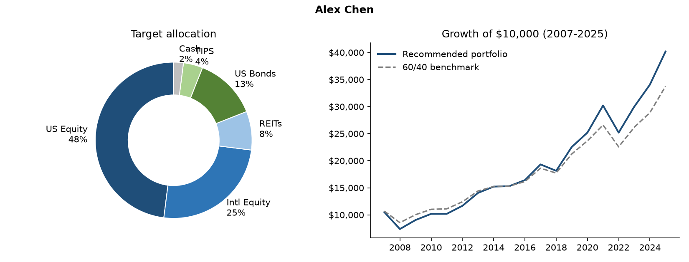

# Investment Policy Statement: Alex Chen
*Prepared November 03, 2026. Illustrative model output, not investment advice.*

## 1. Client summary
- **Age:** 27  |  **Time horizon:** 35 years
- **Portfolio value:** $45,000  |  **Annual contribution:** $12,000
- **Primary objective:** Long-term capital appreciation
- **Near-term liquidity need (next ~3 years):** 2% of portfolio
- **Maximum one-year loss the client can tolerate:** 40%

## 2. Risk profile
| Measure | Score (0-10) |
|---|---|
| Risk tolerance (willingness) | 7.5 |
| Risk capacity (ability) | 9.3 |
| **Blended risk score** (80% weight on the lower) | **7.9** |

**How the recommendation was reached:**
- Tolerance (7.5) is below capacity (9.3); score pulled toward tolerance so the client can stick with the plan.
- Goal 'growth' adjusts equity by +5%.

## 3. Strategic asset allocation
| Asset class | Target | Range | Benchmark index |
|---|---|---|---|
| US Equity | 48% | 43% - 53% | S&P 500 TR |
| Intl Equity | 25% | 20% - 30% | MSCI EAFE (net) |
| REITs | 8% | 5% - 11% | FTSE Nareit All Equity |
| US Bonds | 13% | 8% - 18% | Bloomberg US Aggregate |
| TIPS | 4% | 1% - 7% | Bloomberg US TIPS |
| Cash | 2% | 0% - 4% | 3-month T-bill |
| **Total equity** | **80%** | | |

## 4. Rebalancing and cash-flow policy
- Review at least annually; rebalance when any asset class moves outside its range.
- Direct new contributions to underweight asset classes first to limit trading and taxes.
- Fund withdrawals from overweight classes and the cash bucket before selling underweights.
- Reassess the plan after any major life event (job change, inheritance, health, retirement date).

## 5. Historical stress tests (2007-2025)
| Scenario | Portfolio | 60/40 benchmark | Dollar impact |
|---|---|---|---|
| 2008 Global Financial Crisis | -29.8% | -19.9% | -$13,405 |
| 2020 calendar year (hides the March crash) | 11.8% | 11.4% | $5,288 |
| 2022 Rate shock (stocks and bonds down) | -16.6% | -15.2% | -$7,465 |
| 2007-2009 Crisis cycle | -9.6% | 0.3% | -$4,316 |
| Full period | 301.8% | 237.5% | $135,790 |

| Metric (full period) | Portfolio | 60/40 benchmark |
|---|---|---|
| CAGR | 7.6% | 6.6% |
| Volatility | 14.0% | 10.9% |
| Worst year | -29.8% | -19.9% |
| Max drawdown | -29.8% | -19.9% |
| Sharpe ratio | 0.49 | 0.52 |

## 6. Important limitations
- Backtests use **annual** returns, so intra-year drawdowns (e.g. March 2020) are understated.
- Past performance does not predict future results; the model assumes annual rebalancing and no fees, taxes, or trading costs.
- Historical data in this repo is approximate; verify against a licensed data source before relying on it.
- Questionnaire-based scoring is a starting point for an advisor conversation, not a substitute for it.
