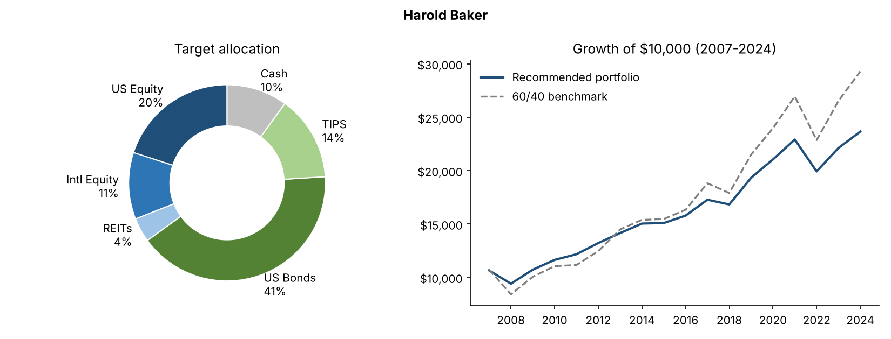

# Investment Policy Statement: Harold Baker
*Prepared November 03, 2026. Illustrative model output, not investment advice.*

## 1. Client summary
- **Age:** 68  |  **Time horizon:** 15 years
- **Portfolio value:** $1,400,000  |  **Annual contribution:** $0
- **Primary objective:** Generate sustainable portfolio income with moderate growth
- **Near-term liquidity need (next ~3 years):** 10% of portfolio
- **Maximum one-year loss the client can tolerate:** 10%

## 2. Risk profile
| Measure | Score (0-10) |
|---|---|
| Risk tolerance (willingness) | 2.5 |
| Risk capacity (ability) | 5.9 |
| **Blended risk score** (80% weight on the lower) | **3.2** |

**How the recommendation was reached:**
- Tolerance (2.5) is below capacity (5.9); score pulled toward tolerance so the client can stick with the plan.
- Goal 'income' adjusts equity by -5%.
- Cash set to 10% to cover near-term withdrawals.
- WARNING: worst historical year is -13.0%, beyond the client's 10% limit, and cutting equity further does not fix it (the loss comes from bonds, as in 2022). Discuss expectations with the client or consider a larger cash or short-duration bucket.

## 3. Strategic asset allocation
| Asset class | Target | Range | Benchmark index |
|---|---|---|---|
| US Equity | 20% | 15% - 25% | S&P 500 TR |
| Intl Equity | 11% | 6% - 16% | MSCI EAFE (net) |
| REITs | 4% | 1% - 7% | FTSE Nareit All Equity |
| US Bonds | 41% | 36% - 46% | Bloomberg US Aggregate |
| TIPS | 14% | 11% - 17% | Bloomberg US TIPS |
| Cash | 10% | 8% - 12% | 3-month T-bill |
| **Total equity** | **35%** | | |

## 4. Rebalancing and cash-flow policy
- Review at least annually; rebalance when any asset class moves outside its range.
- Direct new contributions to underweight asset classes first to limit trading and taxes.
- Fund withdrawals from overweight classes and the cash bucket before selling underweights.
- Reassess the plan after any major life event (job change, inheritance, health, retirement date).

## 5. Historical stress tests (2007-2024)
| Scenario | Portfolio | 60/40 benchmark | Dollar impact |
|---|---|---|---|
| 2008 Global Financial Crisis | -11.7% | -21.7% | -$164,304 |
| 2020 calendar year (hides the March crash) | 8.9% | 11.5% | $124,642 |
| 2022 Rate shock (stocks and bonds down) | -13.0% | -15.2% | -$182,602 |
| 2007-2009 Crisis cycle | 7.3% | 0.6% | $101,874 |
| Full period | 136.6% | 193.0% | $1,912,079 |

| Metric (full period) | Portfolio | 60/40 benchmark |
|---|---|---|
| CAGR | 4.9% | 6.2% |
| Volatility | 7.6% | 11.4% |
| Worst year | -13.0% | -21.7% |
| Max drawdown | -13.0% | -21.7% |
| Sharpe ratio | 0.49 | 0.47 |

## 6. Important limitations
- Backtests use **annual** returns, so intra-year drawdowns (e.g. March 2020) are understated.
- Past performance does not predict future results; the model assumes annual rebalancing and no fees, taxes, or trading costs.
- Historical data in this repo is approximate; verify against a licensed data source before relying on it.
- Questionnaire-based scoring is a starting point for an advisor conversation, not a substitute for it.
