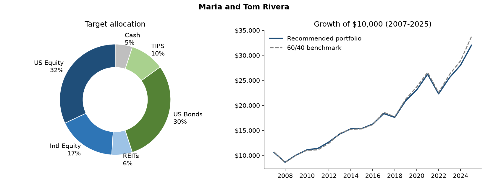

# Investment Policy Statement: Maria and Tom Rivera
*Prepared November 03, 2026. Illustrative model output, not investment advice.*

## 1. Client summary
- **Age:** 52  |  **Time horizon:** 13 years
- **Portfolio value:** $850,000  |  **Annual contribution:** $30,000
- **Primary objective:** Accumulate and sustain assets for retirement
- **Near-term liquidity need (next ~3 years):** 5% of portfolio
- **Maximum one-year loss the client can tolerate:** 25%

## 2. Risk profile
| Measure | Score (0-10) |
|---|---|
| Risk tolerance (willingness) | 5.0 |
| Risk capacity (ability) | 6.1 |
| **Blended risk score** (80% weight on the lower) | **5.2** |

**How the recommendation was reached:**
- Tolerance (5.0) is below capacity (6.1); score pulled toward tolerance so the client can stick with the plan.
- Cash set to 5% to cover near-term withdrawals.

## 3. Strategic asset allocation
| Asset class | Target | Range | Proxy ETF |
|---|---|---|---|
| US Equity | 32% | 27% - 37% | SPY (S&P 500) |
| Intl Equity | 17% | 12% - 22% | EFA (MSCI EAFE) |
| REITs | 6% | 3% - 9% | VNQ (US REITs) |
| US Bonds | 30% | 25% - 35% | AGG (US Aggregate Bond) |
| TIPS | 10% | 7% - 13% | TIP (US TIPS) |
| Cash | 5% | 3% - 7% | SHV (0-1yr Treasuries) |
| **Total equity** | **55%** | | |

## 4. Rebalancing and cash-flow policy
- Review at least annually; rebalance when any asset class moves outside its range.
- Direct new contributions to underweight asset classes first to limit trading and taxes.
- Fund withdrawals from overweight classes and the cash bucket before selling underweights.
- Reassess the plan after any major life event (job change, inheritance, health, retirement date).

## 5. Historical stress tests (2007-2025)
| Scenario | Portfolio | 60/40 benchmark | Dollar impact |
|---|---|---|---|
| 2008 Global Financial Crisis | -18.4% | -19.9% | -$156,822 |
| 2020 calendar year (hides the March crash) | 10.2% | 11.4% | $87,121 |
| 2022 Rate shock (stocks and bonds down) | -14.9% | -15.2% | -$126,853 |
| 2007-2009 Crisis cycle | 0.6% | 0.3% | $5,019 |
| Full period | 220.2% | 237.5% | $1,872,056 |

| Metric (full period) | Portfolio | 60/40 benchmark |
|---|---|---|
| CAGR | 6.3% | 6.6% |
| Volatility | 10.1% | 10.9% |
| Worst year | -18.4% | -19.9% |
| Max drawdown | -18.4% | -19.9% |
| Sharpe ratio | 0.52 | 0.52 |

## 6. Important limitations
- Backtests use **annual** returns, so intra-year drawdowns (e.g. March 2020) are understated.
- Past performance does not predict future results; the model assumes annual rebalancing and no fees, taxes, or trading costs.
- Returns are calendar-year total returns of ETF proxies (net of fund expenses), so they differ slightly from the underlying indexes.
- Questionnaire-based scoring is a starting point for an advisor conversation, not a substitute for it.
